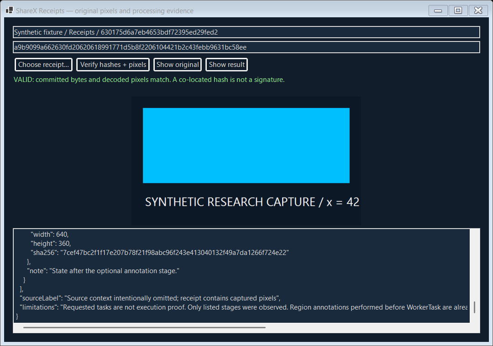

# ShareX Receipts

**Keep the original. Commit the processing evidence. Verify the result.**

An actual source-fork integration for ShareX 21.0.0: an opt-in After capture task saves the accepted input bitmap as a lossless PNG, the exact final file, and a bounded processing record. An in-app inspector verifies the bundle and shows the preserved original. A portable Windows CLI provides independent byte and decoded-pixel checks.

[Interactive showcase and local browser verifier](https://az9713.github.io/rea-sharex-receipts/) · [Releases](https://github.com/az9713/rea-sharex-receipts/releases) · [Upstream source](https://github.com/ShareX/ShareX/tree/d2502561f63fc3ff502cacd91514e3f7f2948c74)



## What changed in the app

- **After capture tasks → Save research receipt (original + processing evidence)** preserves the WorkerTask input before optional beautification, effects and annotation. The option also saves a capture file even if the ordinary Save image task is unchecked.
- **Tools → Research receipt inspector** opens a dark receipt browser. **Task list right-click → Verify research receipt** follows the selected capture's sidecar to the committed bundle. This context command uses the task list, including history entries loaded into it; it does not add a button to the separate upstream History window.
- The receipt seals after external file actions and before OCR/upload/delete. Requested task flags and actually observed image boundaries are separate fields. Original pixels remain available even when the output is JPEG or an external action changes the file.
- **SSH.NET 2026.0.0** replaces upstream 2025.1.0. This removes the two NuGet advisory warnings observed during the baseline build. It is not a comprehensive security audit, and SCP/SFTP/network transfers were not exercised.

The installed ShareX application was not patched or launched. This project builds a separate modified executable from matching public source. It is independent of REA at runtime.

## Try the portable release

Requires Windows x64; the full fork targets Windows 11 build 22621 or later. Download and extract `ShareX-Receipts-v0.1.1-win-x64.zip`. Keep its directory intact. It contains its .NET runtime and an upstream Portable marker. For a synthetic demonstration that bypasses the normal ShareX profile/startup path:

```powershell
.\ShareX.exe --receipt-self-test .\synthetic-demo
Get-Content .\synthetic-demo\integration-result.json
```

This runs the **actual WorkerTask.DoThreadJob** with a generated bitmap and JPEG quality 40, checks that the original pixels match and the JPEG pixels differ, and briefly renders the receipt inspector. It captures no desktop, invokes no OCR/upload and loads no normal ShareX settings. Use a fresh output directory on each run; existing links are intentionally preserved.

Open an existing receipt directly:

```powershell
.\ShareX.exe --receipt-inspector .\synthetic-demo\Receipts\RECEIPT_ID
```

For normal app use, run the portable ShareX.exe, set the capture output to a dedicated test folder, enable the new After capture task, and capture a synthetic test document. Normal ShareX behavior, hotkeys and network settings remain upstream behavior; the isolated test does not validate every normal app feature. Normal capture was not exercised against this laptop's real desktop.

The separate `Receipt-CLI-v0.1.1-win-x64.zip` also needs no global .NET install:

```powershell
.\receipt.exe demo .\demo-receipts
.\receipt.exe verify .\demo-receipts\RECEIPT_ID
.\receipt.exe verify .\demo-receipts\RECEIPT_ID INDEPENDENTLY_RETAINED_SHA256
```

Exit codes: 0 verified/success, 2 invalid receipt, 1 runtime error, 64 usage. The CLI outputs structured JSON. Preserve the receipt digest separately if you need to detect a rewrite of the complete bundle.

## Receipt contract

Each immutable `Receipts/<id>/` directory contains exactly:

| File | Commitment |
|---|---|
| `original.png` | Lossless accepted WorkerTask input and canonical pixel identity |
| `result.<ext>` | Exact final file after file actions; decoded pixel identity when it is an image |
| `recipe.json` | Requested tasks, selected image settings, observed boundary pixel hashes, explicit limitations |
| `receipt.json` | Schema, producer, source revision, lengths, SHA-256 hashes and pixel identities |
| `receipt.sha256` | SHA-256 of the exact receipt.json bytes |

A `<capture>.receipt-link.json` beside the ordinary output stores the receipt ID and digest for task-list discovery. It is a convenient anchor, not an independent trusted source. A receipt publishes by staging and renaming on the same volume; existing receipt IDs and sidecars are never overwritten. Failure after publication but before sidecar writing can leave a valid unlinked receipt, recoverable through Tools.

Canonical pixels: SHA-256 of ASCII `sharex-pixels-v1\n`, width and height as little-endian signed 32-bit integers, then RGBA8 rows from top to bottom. PNG decoding/encoding is supplied by Windows GDI+. The manifest commits exact bytes, so formatting changes count as changes.

## What verification establishes

The Windows verifier checks schema, file roles, names, read budgets, exact directory membership, byte lengths/hashes, receipt hash and decoded original/result pixels. It rejects linked receipt directories and linked payload files. It does not protect against linked ancestors, concurrent filesystem replacement, hostile-image decoder vulnerabilities or an attacker with control of the process. Use it on locally created or trusted receipts, not as a sandbox for adversarial image files. Artifacts are limited to 512 MiB, recipes/manifest to 1 MiB.

A co-located hash is **integrity evidence, not authenticity**. Anyone able to rewrite all files can regenerate the hashes. An independently retained digest detects that rewrite; digital signing, trusted timestamps, key management and OS-capture attestation are not implemented. Region annotations made before WorkerTask are already part of the original. The recipe is a committed observation/intent summary, not a complete executable effect replay. Selected settings are recorded at sealing; effect parameter graphs, external process internals, OCR and upload are outside the attestation.

## Rebuild and verify

Prerequisites: Windows x64, PowerShell, Git, Python 3 and network access to public GitHub/Microsoft/NuGet. Scripts download a **portable .NET SDK 9.0.320**, verify its official metadata SHA-512, and keep their SDK/cache/temp directories inside this checkout. No global install is required.

```powershell
.\scripts\build.ps1 -Publish
.\scripts\test.ps1
.\scripts\package.ps1
```

`prepare-fork.ps1` acquires tag v21.0.0 and checks peeled commit **d2502561f63fc3ff502cacd91514e3f7f2948c74** before applying narrow source anchors and copying the integration files. Unexpected source shapes fail. The checked-in patch documents tracked upstream changes; the patcher plus integration sources are authoritative for reproduction. Source is pinned, but dependency/runtime restoration and compiler output are not claimed bit-for-bit reproducible.

Tests cover canonical RGBA/alpha/dimensions, PNG roundtrip, valid receipts, original/result/recipe/manifest tampering, missing/extra files, traversal/schema rejection, forged pixel commitments, independent anchors, immutable IDs and requested-versus-observed semantics. The modified executable's synthetic WorkerTask test exercises the integration and renders the inspector. The release verification also runs the published self-contained executables. See [validation](docs/validation.json) and [investigation](investigation/findings.md).

## REA evidence and attribution

REA's read-only managed analysis identified ShareX 21.0.0.0 targeting .NET9, motivating the matching public source route. Static metadata analysis did not decompile C#, execute ShareX or establish source/binary equivalence. Public source inspection then traced capture → WorkerTask → file actions → history/task list. Receipt implementation and all execution evidence were produced by this project, not inferred from REA's analysis. The sanitized evidence receipt is [investigation/rea-evidence.json](investigation/rea-evidence.json); it omits local installation paths and personal inventory.

## License

GPL-3.0-or-later for new code; see [LICENSE](LICENSE) and [NOTICE.md](NOTICE.md). Upstream headers and third-party notices are retained. Every modified binary release must include the matching full corresponding-source archive. This is an experimental independent fork, not an official ShareX release.

## Release 0.1.1: compiler path privacy

This rebuild maps local source paths to virtual `/_/` paths before compilation, disables debug metadata for the Avalonia-rewritten image-editor assembly, and checks every packaged PE file for literal project/profile path markers in ASCII/UTF8 and UTF16LE. Debug-symbol files are excluded too. The 0.1.0 binary packages are superseded because compiler metadata retained local build paths. The source and feature behavior are otherwise unchanged. This bounded scan does not establish the absence of every possible embedded or compressed private value.
